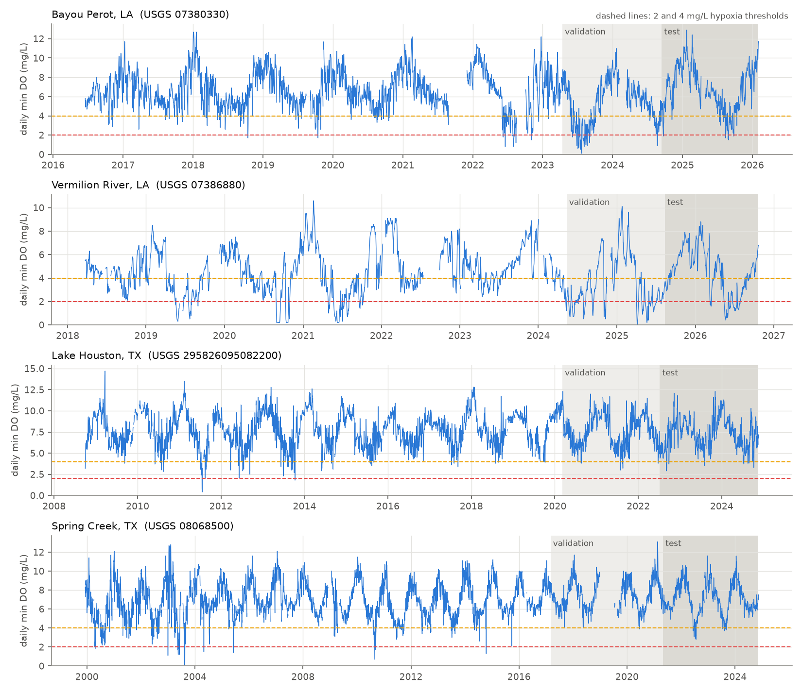
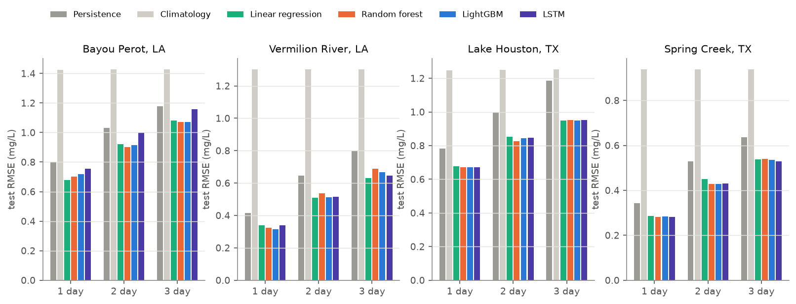
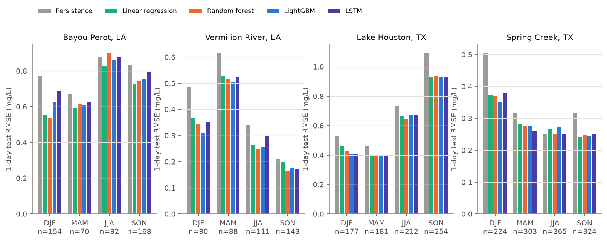
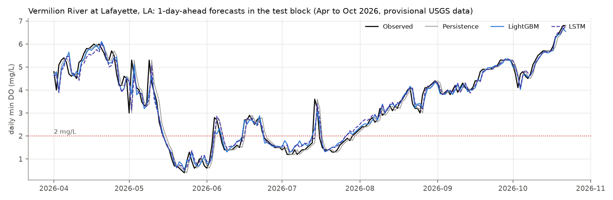
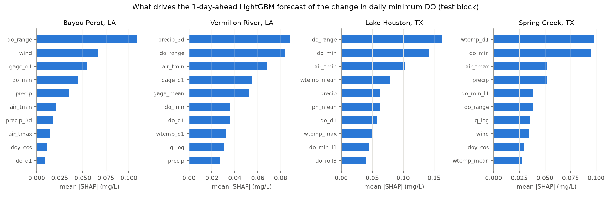
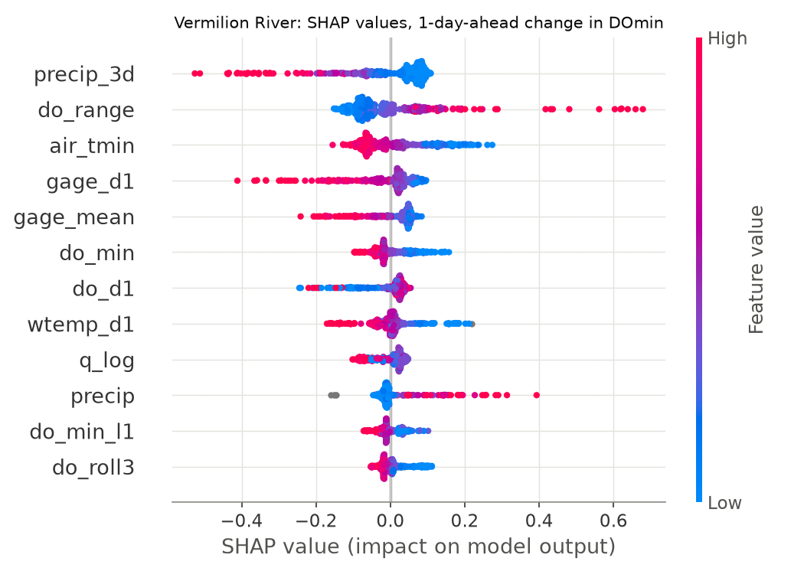
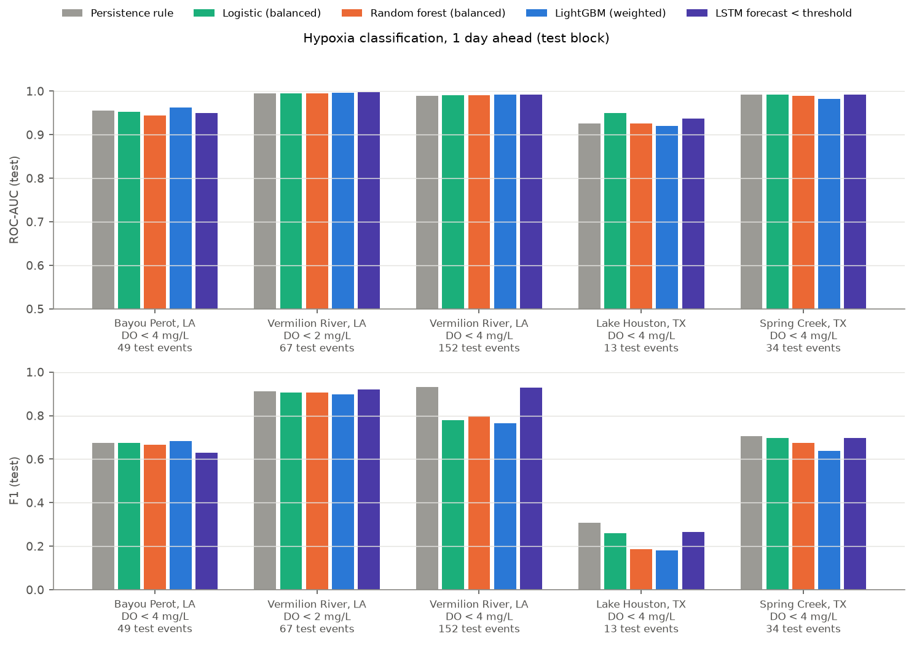
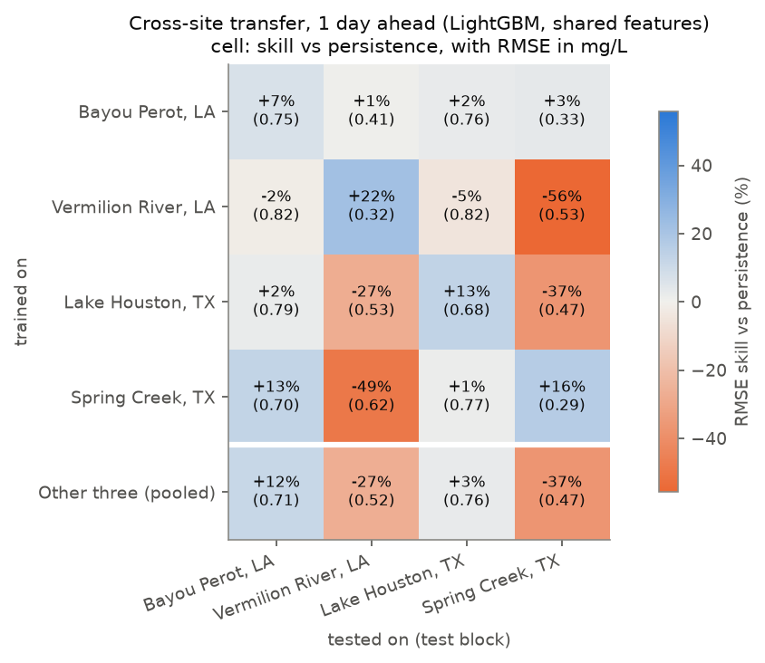

# Forecasting Daily Minimum Dissolved Oxygen and Hypoxia Risk at Louisiana and Texas Monitors

**Author:** Anamika Dristi, Ph.D.

This project forecasts the daily minimum dissolved oxygen (DO) concentration 1, 2 and 3 days ahead at four continuous USGS water-quality monitors: two in coastal Louisiana (Bayou Perot in the Barataria estuary and the Vermilion River at Lafayette) and two in the Houston area (Lake Houston and Spring Creek). It also classifies the risk of hypoxia (DO below 2 or 4 mg/L). It compares persistence, climatology and linear regression baselines with random forest, LightGBM gradient boosting and a small PyTorch LSTM, all under time-ordered train, validation and test splits. On the test periods, the machine learning models cut 1-day RMSE by 10 to 24 percent compared with persistence. The deep learning model did not beat gradient boosting in any consistent way. A model trained at one site often did worse than persistence at another site.

This is an independent analysis of public data, separate from my LSU dissertation datasets. No field or laboratory data from my graduate work are used here.

## Why it matters

- **Environmental and public health monitoring:** low DO causes fish kills and is a common reason Louisiana and Texas water bodies are listed as impaired under Clean Water Act section 303(d). Even a 1 to 3 day warning helps agencies, utilities and aquaculture operators plan sampling, aeration or advisories.
- **Coastal and estuarine science:** Barataria Basin hypoxia links to river diversions, salinity and wind mixing, which are active topics in Louisiana coastal restoration.
- **Data science for environmental agencies:** the workflow (USGS web services, leakage-free time splits, baselines first, SHAP explanations, a transfer test) can be reused for other parameters and regions, for example by TCEQ, LDEQ, TWDB, river authorities and consulting firms.

## Data sources

All data are public and were downloaded without accounts or API keys on **2026-10-23**.

| Site (USGS ID) | Setting | USGS service used | Period used | Days with DO minimum | Median daily min DO (mg/L) | Days below 2 / 4 mg/L | Other variables |
|---|---|---|---|---|---|---|---|
| Bayou Perot at Point Legard near Cutoff, LA ([07380330](https://waterdata.usgs.gov/monitoring-location/07380330/)) | Barataria Basin brackish estuary | 15-minute values, aggregated to daily | 2016-06-17 to 2026-02-02 | 3,237 | 6.4 | 1.8% / 10.8% | water temperature, specific conductance, salinity, pH, turbidity, gage height |
| Vermilion River at Surrey St. at Lafayette, LA ([07386880](https://waterdata.usgs.gov/monitoring-location/07386880/)) | freshwater coastal-plain river | 15-minute values, aggregated to daily | 2018-03-24 to 2026-10-22 | 2,894 | 4.3 | 11.6% / 41.4% | water temperature, discharge, gage height, turbidity |
| Lake Houston S Union Pacific RR Bridge near Houston, TX ([295826095082200](https://waterdata.usgs.gov/monitoring-location/295826095082200/)) | water-supply reservoir | daily values (USGS daily min, mean, max) | 2008-09-30 to 2024-11-18 | 5,576 | 7.6 | 0.1% / 1.6% | water temperature, specific conductance, pH, turbidity |
| Spring Creek near Spring, TX ([08068500](https://waterdata.usgs.gov/monitoring-location/08068500/)) | urbanizing Houston-area stream | daily values (USGS daily min, mean, max) | 1999-12-10 to 2024-11-13 | 8,218 | 6.8 | 0.3% / 3.8% | water temperature, specific conductance, pH, turbidity, discharge, gage height |

USGS parameter codes: 00300 DO, 00010 water temperature, 00095 specific conductance, 00480 salinity, 00400 pH, 63680 turbidity, 00060 discharge, 00065 gage height.

- **Site selection:** I queried the [USGS NWIS Site Service](https://waterservices.usgs.gov/nwis/site/) for every Louisiana and Texas site with DO data. I kept sites with several years of continuous DO plus companion sensors, and favored coastal Louisiana and Houston-area water bodies. Buffalo Bayou monitors (at Houston and at the Turning Basin of the Houston Ship Channel) were considered, but their daily DO records ended in 2000 and 2005, so the longer and more recent Lake Houston and Spring Creek records were used.
- **USGS data:** [NWIS Daily Values](https://waterservices.usgs.gov/nwis/dv/) and [NWIS Instantaneous Values](https://waterservices.usgs.gov/nwis/iv/) web services, JSON format. Values flagged for equipment problems, ice, maintenance or similar were dropped. Approved and provisional values were both kept. Provisional values make up 2.3% of the Bayou Perot DO readings and 20% of the Vermilion River readings, mostly in the most recent test period. The Texas daily values were all approved.
- **Weather:** NOAA NCEI [GHCN-Daily](https://www.ncei.noaa.gov/products/land-based-station/global-historical-climatology-network-daily) through the keyless [Access Data Service](https://www.ncei.noaa.gov/access/services/data/v1). It supplies daily maximum and minimum air temperature, precipitation and average wind speed from New Orleans International Airport (USW00012916, used for Bayou Perot), Lafayette Regional Airport (USW00013976) and Houston Intercontinental Airport (USW00012960, used for both Texas sites).
- `data/` holds the cleaned daily tables (`daily_<site>.csv`) and a site summary (`sites.csv`). The raw downloads (about 175 MB) are not stored. `scripts/01_download_data.py` fetches them again.

## Methods

1. **Daily tables** (`02_build_daily_dataset.py`): the 15-minute values for the Louisiana sites were aggregated to local-day minimum, mean and maximum. A day was kept only if it had at least 75 percent of the usual number of readings. The Texas sites use the USGS daily statistics. DO values outside 0 to 25 mg/L were removed.
2. **Features at issue day t** (`do_common.py`): DOmin, DOmean, DOmax, diel DO range, DOmin lags 1 to 6 days, 3 and 7 day rolling means, day-to-day change, water temperature (mean, max, change, 7-day mean), the site's other sensors (specific conductance, salinity, pH mean and diel range, log turbidity, log discharge, gage height and its change), airport weather (air temperature, precipitation over 1, 3 and 7 days, wind over 1 and 3 days) and day of year as sine and cosine. Only data available by the end of day t are used. Weather on the forecast day is not used, so the forecasts do not assume a perfect weather forecast.
3. **Target:** DOmin on day t+h, for h = 1, 2 and 3. The tabular ML models and the LSTM predict the change from today's DOmin, which is then added back.
4. **Splits without leakage:** each site's record is split by date into training (first 70% of usable days), validation (next 15%) and test (last 15%). Rows whose 3-day-ahead target would fall in the next block are dropped at each boundary. Imputation medians, scaling, climatology and LSTM normalization are fit on the training block only. The validation block is used only for early stopping, a small LightGBM grid (leaves 7, 15 or 31; minimum leaf size 20 or 50) and classifier thresholds. The test block is scored once.
5. **Models** (`03_train_lstm.py`, `04_train_forecast_models.py`):
   - persistence (DOmin(t+h) = DOmin(t));
   - climatology (smoothed day-of-year mean of training DOmin);
   - ordinary least squares linear regression;
   - random forest (300 trees, min leaf 5);
   - LightGBM (learning rate 0.03, early stopping);
   - an LSTM in PyTorch on CPU. It has one layer with 32 hidden units, about 6,500 parameters, and reads 14-day input sequences. One multi-horizon model is trained per site, with early stopping, and the predictions of 3 random seeds are averaged.
6. **Regression metrics:** RMSE, MAE, Nash-Sutcliffe efficiency (NSE) and Kling-Gupta efficiency (KGE, 2009 form).
7. **Hypoxia classification** (`05_hypoxia_classification.py`): the labels are DOmin(t+h) < 2 mg/L and < 4 mg/L. Classifiers are logistic regression (balanced class weights), random forest (balanced subsample weights) and LightGBM (`scale_pos_weight` = negatives/positives). Each classifier's alarm threshold was set to maximize F1 on the validation block. Two simple rules are also scored: a persistence rule (alarm if today is already below the threshold) and the LSTM forecast below the threshold. Metrics are ROC-AUC, PR-AUC, precision, recall and F1. A case was scored only if the training block had at least 15 events and the test block had at least 5.
8. **Interpretability** (`06_shap_interpretability.py`): SHAP TreeExplainer on the 1-day LightGBM models, computed on the test block.
9. **Cross-site transfer** (`07_cross_site_transfer.py`): LightGBM using only the features all four sites share. Each model is trained on one site and tested on every site's test block. A pooled model trained on the other three sites (leave one site out) was also tested.

## Key findings

All numbers are test-block results from my own run of the scripts in this repository.

**Model comparison, test RMSE (mg/L) of the daily minimum DO forecast** (full table with MAE, NSE and KGE in `outputs/tables/forecast_metrics.csv` and `model_comparison_test.csv`):

| Site | Horizon | n | Persistence | Climatology | Linear | Random forest | LightGBM | LSTM |
|---|---|---|---|---|---|---|---|---|
| Bayou Perot, LA | 1 day | 484 | 0.803 | 1.424 | **0.680** | 0.702 | 0.719 | 0.756 |
| | 2 day | 482 | 1.032 | 1.427 | 0.920 | **0.903** | 0.914 | 1.001 |
| | 3 day | 480 | 1.177 | 1.429 | 1.082 | 1.073 | **1.070** | 1.157 |
| Vermilion River, LA | 1 day | 432 | 0.414 | 1.302 | 0.339 | 0.323 | **0.314** | 0.338 |
| | 2 day | 430 | 0.645 | 1.303 | **0.508** | 0.536 | 0.511 | 0.515 |
| | 3 day | 428 | 0.801 | 1.303 | **0.631** | 0.687 | 0.666 | 0.645 |
| Lake Houston, TX | 1 day | 824 | 0.783 | 1.248 | 0.678 | **0.671** | 0.672 | **0.671** |
| | 2 day | 818 | 0.999 | 1.250 | 0.852 | **0.825** | 0.843 | 0.846 |
| | 3 day | 815 | 1.187 | 1.254 | 0.950 | 0.952 | **0.948** | 0.952 |
| Spring Creek, TX | 1 day | 1216 | 0.343 | 0.938 | 0.287 | 0.282 | 0.283 | **0.282** |
| | 2 day | 1205 | 0.530 | 0.938 | 0.450 | 0.429 | **0.428** | 0.430 |
| | 3 day | 1197 | 0.637 | 0.939 | 0.538 | 0.541 | 0.535 | **0.530** |

- **The ML models beat both naive baselines everywhere.** Compared with persistence, LightGBM lowered RMSE by 10.5% (Bayou Perot), 24.0% (Vermilion), 14.2% (Lake Houston) and 17.4% (Spring Creek) at 1 day ahead. Its 1-day NSE was 0.90, 0.97, 0.84 and 0.97, and its 3-day NSE was 0.78, 0.885, 0.68 and 0.88. Climatology was much worse than persistence at every site (1-day NSE 0.45 to 0.65), so short-term memory matters far more than season.
- **The LSTM did not beat gradient boosting.** Across the 12 site and horizon cases, the LSTM was better than LightGBM in 4, but by no more than 0.021 mg/L. It was 0.04 to 0.09 mg/L worse at Bayou Perot at every horizon. At Bayou Perot the LSTM was slightly better on the validation block (which held the 2023 low-DO period) but worse on the test block, which points to overfitting on a short, shifting record. The three LSTM seeds varied by up to 0.04 mg/L in RMSE, about as large as the differences between models.
- **Plain linear regression was competitive.** It had the lowest RMSE in 3 of 12 cases (Bayou Perot at 1 day and the Vermilion River at 2 and 3 days). On these daily, persistence-dominated series the extra complexity buys little. The largest gain comes from moving beyond persistence at all.
- **KGE tells a slightly different story:** at Bayou Perot, persistence had a higher KGE (0.94 at 1 day) than any ML model (0.90 to 0.93). The ML models smooth the forecast and understate variability, even though their squared errors are smaller.
- **Error by season** (`fig03`, `error_by_season_test.csv`): 1-day errors were largest in summer (JJA) at Bayou Perot, in autumn (SON) at Lake Houston (RMSE about 0.93 mg/L for all ML models), in spring (MAM) at the Vermilion River, and in winter (DJF) at Spring Creek. The ML gain over persistence was smallest in summer at Bayou Perot and Spring Creek, where some ML models were no better than persistence. Summer is the season when hypoxia matters most.
- **Hypoxia risk, 1 day ahead** (`hypoxia_metrics.csv`):
  - DO < 4 mg/L reached test ROC-AUC 0.92 to 0.99 at all four sites. DO < 2 mg/L reached 0.99 at the Vermilion River.
  - The simple persistence rule was very hard to beat on F1. At the Vermilion River (< 4 mg/L), persistence F1 was 0.93 and the LSTM-forecast rule 0.93, while the weighted classifiers scored 0.76 to 0.80. Their validation-tuned thresholds were too strict for the test period: precision 1.00 but recall 0.62 to 0.66.
  - At Lake Houston only 13 of 824 test days were below 4 mg/L, and every method had F1 of 0.31 or lower.
  - DO < 2 mg/L could not be scored at Lake Houston (3 training events), Spring Creek (no validation or test events) or Bayou Perot (13 training events). These are honest limits of rare-event data, not of the method.
- **SHAP** (`fig05`, `fig06`): the diel DO range was a top-2 driver at three of four sites. A wide range today pushes the forecast of tomorrow's minimum up, consistent with strong daytime photosynthesis and with recovery after a one-day dip. At the Vermilion River, 3-day rainfall and rising gage height pushed the forecast minimum down, consistent with runoff delivering oxygen-demanding material. At Bayou Perot, wind speed ranked second, consistent with wind mixing in a shallow estuary. At Spring Creek, the day-to-day change in water temperature ranked first.
- **Cross-site transfer** (`fig08`, `transfer_metrics.csv`): models transferred poorly to the two sites with the strongest local dynamics. At 1 day ahead, models trained at Lake Houston or Spring Creek scored -27% and -49% skill relative to persistence at the Vermilion River, and models trained at the Vermilion River or Lake Houston scored -56% and -37% at Spring Creek. The pooled leave-one-site-out model also scored -27% (Vermilion) and -37% (Spring Creek). Transfer worked better into Bayou Perot (+13% from Spring Creek, +12% pooled) and was near zero at Lake Houston (-5% to +3%). The Bayou Perot model was the most cautious donor, staying within +1% to +3% of persistence everywhere. Local training (+7% to +22% with the shared features) was the best option at every site, so a DO model should be retrained or at least recalibrated for each water body.

## Figures


*Figure 1. Daily minimum DO at the four sites, with validation and test blocks shaded and the 2 and 4 mg/L thresholds.*


*Figure 2. Test RMSE by model and forecast horizon.*


*Figure 3. 1-day test RMSE by season of the target day (DJF winter, MAM spring, JJA summer, SON autumn).*


*Figure 4. Observed and 1-day-ahead forecast DO minimum at the Vermilion River during the 2026 low-oxygen season (provisional data).*


*Figure 5. Mean absolute SHAP values for the 1-day LightGBM models.*


*Figure 6. SHAP values for each test day at the Vermilion River.*


*Figure 7. Test ROC-AUC and F1 for 1-day hypoxia classification, for the site and threshold combinations with enough events.*


*Figure 8. Cross-site transfer: RMSE skill relative to persistence on each test site.*

## Limitations

- Four sites only. The test blocks are 1.2 to 3.5 years long, and the reported differences between ML models (often 0.01 mg/L) are smaller than the spread across LSTM seeds. No formal significance test was done.
- Each record is one fixed sensor. At Lake Houston the long-term series used here has no depth label (the 6, 12 and 16 ft profile series ran only from 2008 to 2010), so bottom-water hypoxia in the reservoir is probably not captured.
- Recent Louisiana data are partly provisional and may be revised by USGS.
- Airport weather is a rough stand-in for local conditions, especially for Bayou Perot, which is about 50 km from the New Orleans airport.
- Forecasts use only observed data up to day t. An operational system would add weather forecasts and would need to handle sensor outages in real time.
- Hypoxia below 2 mg/L is rare at three of the four sites, so the classification results for that threshold rest on one site.
- The LSTM is deliberately small and lightly tuned. A larger architecture, more input history or pooled multi-site training might narrow the gap, but this was not tested.

## How to run

```bash
python -m venv .venv
source .venv/bin/activate
pip install -r requirements.txt
bash run_all.sh raw_data        # download (about 175 MB) and run every step, a few minutes on a laptop CPU
```

The steps can also be run one at a time (`python scripts/01_download_data.py --raw-dir raw_data`, then 02 to 08 in order). Step 3 (PyTorch) runs in its own process because PyTorch and LightGBM bundle separate OpenMP libraries that can crash together on macOS. USGS keeps revising provisional data, so a rerun at a later date can give slightly different numbers.

## Repository structure

```
README.md, LICENSE, requirements.txt, run_all.sh, .gitignore
scripts/
  01_download_data.py          USGS and NOAA downloads (keyless)
  02_build_daily_dataset.py    daily tables and site summary
  03_train_lstm.py             PyTorch LSTM (CPU)
  04_train_forecast_models.py  baselines, linear, random forest, LightGBM, metrics
  05_hypoxia_classification.py hypoxia risk classifiers
  06_shap_interpretability.py  SHAP for LightGBM
  07_cross_site_transfer.py    transfer and leave-one-site-out tests
  08_make_figures_tables.py    summary tables and figures
  do_config.py, do_common.py, plot_style.py   shared settings and helpers
data/                          cleaned daily tables per site, sites.csv
outputs/tables/                metrics, predictions, SHAP and transfer tables
outputs/figures/               figures 1 to 8
```

## Citation and author

Anamika Dristi, Ph.D. (2026). *Forecasting daily minimum dissolved oxygen and hypoxia risk at Louisiana and Texas USGS monitors with machine learning.* GitHub repository: dissolved-oxygen-forecasting-machine-learning.

Data: U.S. Geological Survey, National Water Information System (accessed 2026-10-23); NOAA National Centers for Environmental Information, GHCN-Daily (accessed 2026-10-23).

Related published work by the author (context only; no data from these studies are used here):
- Dristi, A., and Xu, Y. J. (2023). *Water* 15(14): 2621.
- Dristi, A., and Xu, Y. J. (2025). *Water* 17(17): 2589.
- Dristi, A., et al. (2025). *Estuarine, Coastal and Shelf Science* 324: 109465.

Contact: anamikadristi@gmail.com
